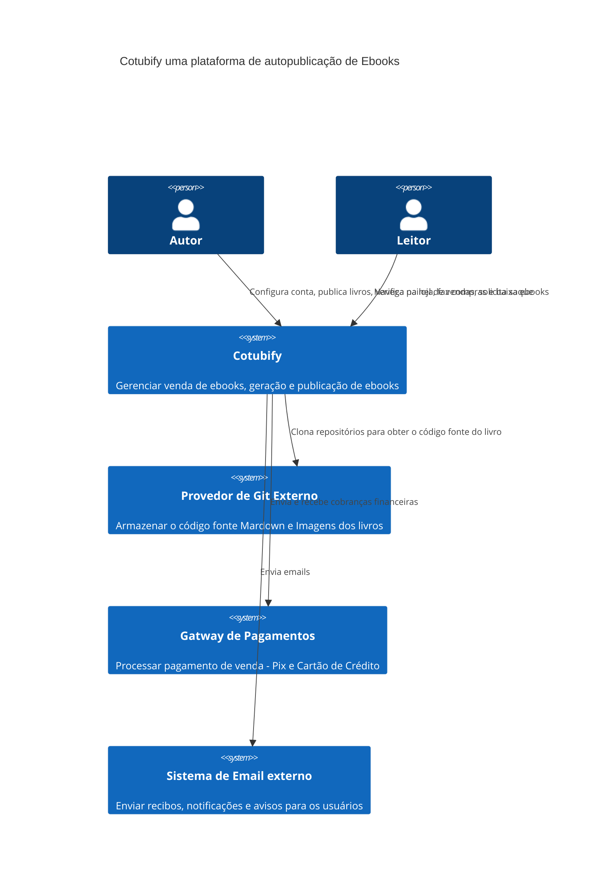
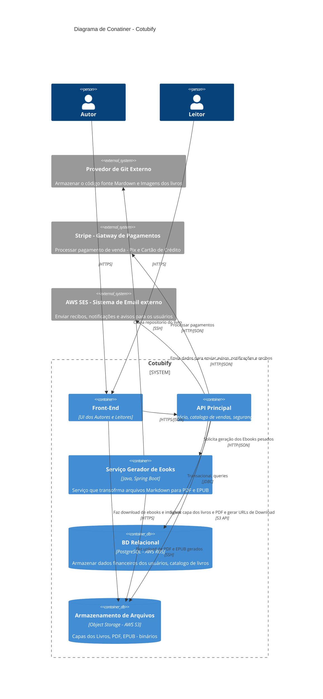

# Arquitetura Cotubify

O Cotubify é uma plataforma de auto-publicação e venda de ebooks.

O sistema permite autores técnicos conectarem repositórios Git com arquivos no formato .md para geração automatizada de ebooks nos formatos de PDF e EPUB.
Autores também tem um painel de vendas.

Permite também que os leitores acessem uam loja on-line para navegação, compra e download das obras.
Os leitores recebem recibos e notificações via email.

## Diagrama de Contexto (C4 Model)

## Diagrama de Containers (C4 Model)

## Decisões Arquiteturais (ADRs)

- [ADR 001: Geração de Ebooks via Mensageria Assincrona](adr/adr-001-geracao-ebooks-assincrona.md)
- [ADR 002: Introdução de Cache em Memória para o Catálogo de E-Books](adr/adr-002-cache-catalogo.md)